<div align="center">


# Car Compare

### Every car from 1899 to today, side by side.

Pick a car for its full spec sheet, or line up two to six and see them against each other: charts, to-scale outlines, 3D models, a race in the wet, a Stage 2 remap, what each costs to run, and whether it fits your garage.


[Features](#-features) · [Screens](#-a-closer-look) · [Where the data comes from](#-where-the-data-comes-from) · [Getting started](#-getting-started) · [Security](#-security) · [Tests](#-tests) · [Accuracy](#-accuracy-notes) · [Release notes](#-release-notes)

<br>

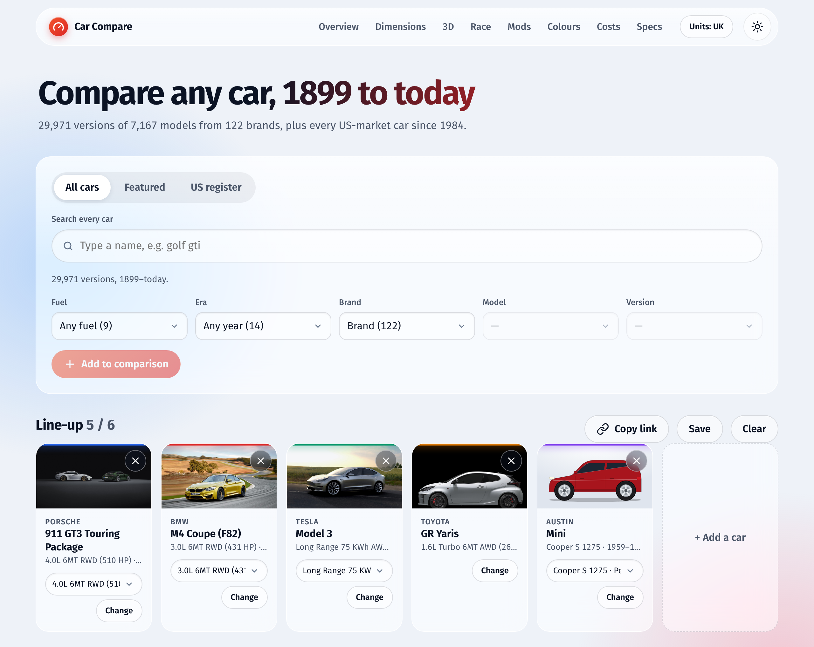

</div>

<br>

## ✦ Why Car Compare

Spec sheets are scattered across a hundred sites, each in its own units, and none of them put a 1964 Mini next to a 2025 911. Car Compare puts them all in one place:

| | |
|---|---|
| 🔎 **Any car, one search box** | Type "golf gti", or narrow it down by fuel, era, brand, model and version. About 30,000 versions of 7,167 models, plus every US-market car since 1984. |
| 📊 **Numbers you can see** | Power, torque, weight, power-to-weight, 0–60, economy and price as bar charts, with the best in each row picked out. |
| 📐 **Real sizes, drawn to scale** | Side, front, rear and top outlines laid over each other, 3D models you can turn, and a garage door to see what fits. |
| 🏁 **Race them** | Eight events in five conditions, run as an animated race. The 911 wins in the dry; see what happens in the snow. |
| 🔧 **Modify them** | Remaps and parts change the power, the 0–60, the race and even the drawings, with a rough cost. |
| 💷 **What it costs to own** | UK car tax, fuel a year from your own mileage and prices, and a ULEZ check. |
| 🪟 **A liquid glass interface** | Frosted glass panels over a soft colour field, in light and dark, on a phone or a big screen, with smooth transitions that switch off if you prefer reduced motion. Cars without a photo get a proper drawing, not a block. |
| 🔒 **Self-hosted and hardened** | One Python file, no packages, rate limits, a read-only database and a strict CSP. Runs on a home server. |

<br>

## ✦ Features

<table>
<tr>
<td width="50%" valign="top">

### Search every car
Type any part of a name and every word must match, across the full database and the Featured catalogue. Click a hit and it's in the line-up. Prefer menus? Filter by fuel, era, brand, model and version instead.

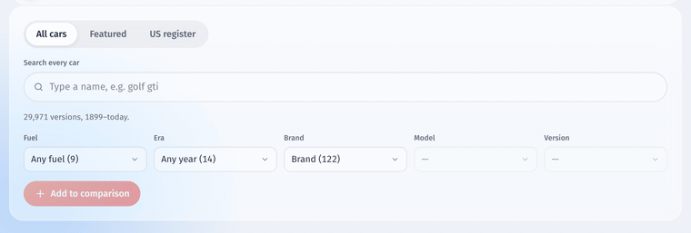

</td>
<td width="50%" valign="top">

### Race in five conditions
0–60, 0–100, ¼ mile, 30–70, 50–100, braking distance, a circuit lap or a mountain pass, in the dry, wet, snow, high altitude or desert heat. Times are estimated from power, weight, drivetrain and grip.

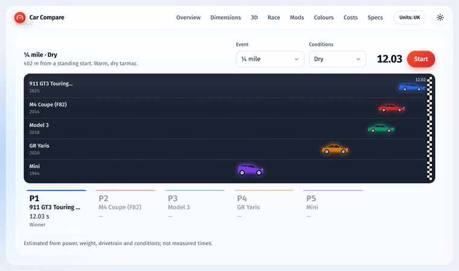

</td>
</tr>
<tr>
<td width="50%" valign="top">

### Turn them in 3D
Every car is built as a 3D model to its real length, width, height and wheelbase, with a curved body, a glasshouse that narrows to the roof and glossy paint. All at the same scale and in the colour you chose. Drag it, or use the arrow keys.

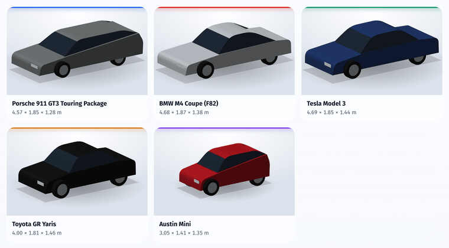

</td>
<td width="50%" valign="top">

### Remap it, then race it again
A Stage 1 or Stage 2 remap plus parts: induction kit, exhaust, intercooler, strip-out, wheels, tyres, coilovers, brakes. Stage 2 ticks the parts it needs. Already tuned? Enter your own dyno figures.


</td>
</tr>
<tr>
<td width="50%" valign="top">

### Will it fit?
The outlines show each car to scale, with the differences in a table. The front view has a UK single garage door (2.13 × 1.98 m). Type your own door or parking space and it tells you which cars fit, and by how much.

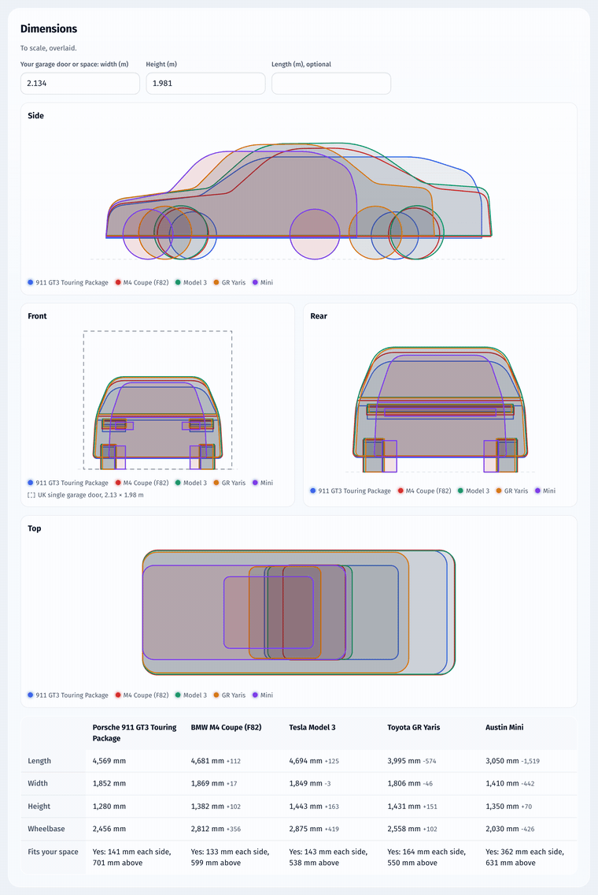

</td>
<td width="50%" valign="top">

### Light or dark, UK or metric
Light and dark themes, and hp/mph/mpg or kW/km/h/L per 100 km. Both are remembered in your browser. **Copy link** shares the exact line-up, mods included, and **Save** keeps it for later.

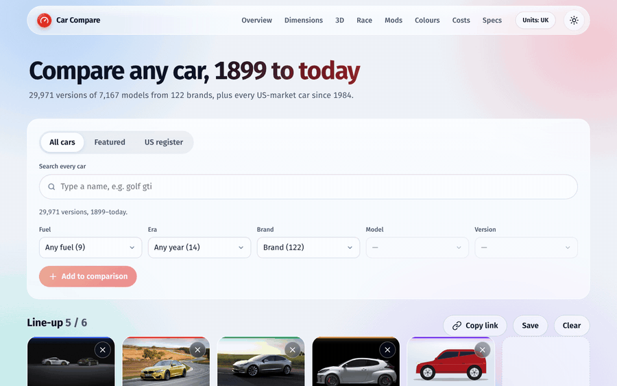

</td>
</tr>
<tr>
<td colspan="2" valign="top">

### Smooth, considerate motion
The page eases in on load, each section rises into view as you scroll, new cars pop into the line-up, chart bars glide to their new length when you change a mod or your mileage, and the theme cross-fades. Turn on *Reduce motion* in your system settings and all of it switches off.

<p align="center">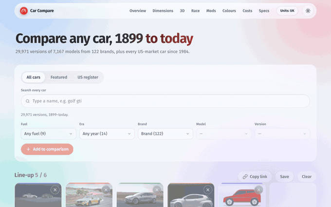</p>

</td>
</tr>
<tr>
<td colspan="2" valign="top">

### The full spec sheet, best in green
Performance, engine, running costs, size, practicality and your chosen options, grouped and side by side. The best figure in each row is green, and anything the importer estimated is marked **≈**.

<p align="center">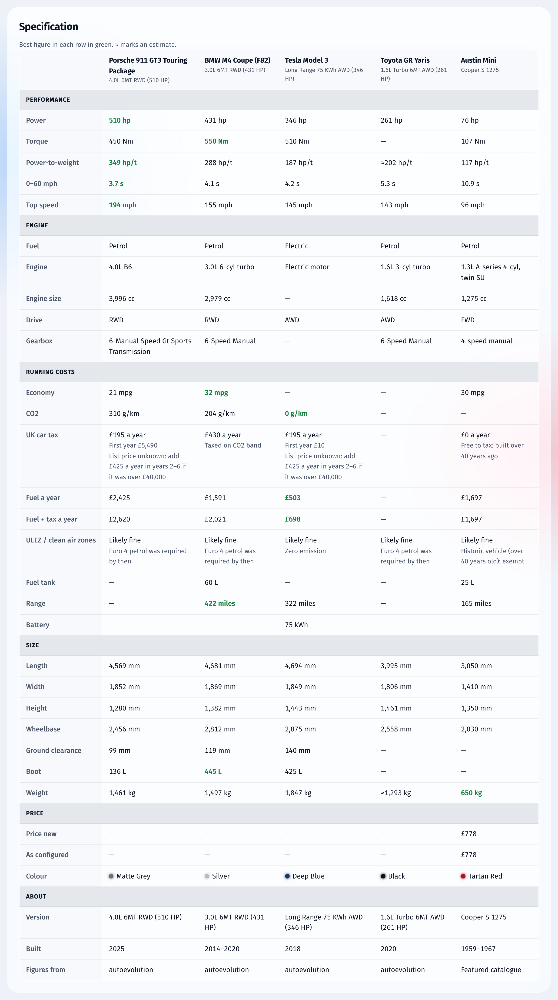</p>

</td>
</tr>
</table>

<details>
<summary><b>Full feature list</b></summary>

<br>

**Finding cars**
- **Search** by name, every word must match, results capped at 20
- **Dropdowns:** fuel type, era, brand, model (grouped by decade), version/trim
- **Three sources** as tabs: the Full database, the Featured catalogue and the live US register (see [below](#-where-the-data-comes-from))

**The line-up**
- Up to **6 cars** with photos, each in its own colour
- A **version dropdown** on each card swaps to another version of the same model in place, keeping its paint
- **Change** loads a car into the finder so you can replace it with any other car in the same position
- **Copy link** shares the exact line-up; **Save** keeps line-ups in your browser

**Comparing**
- **At a glance:** bar charts for power, torque, weight, power-to-weight, 0–60, economy, price, and fuel and tax a year
- **Dimensions to scale:** overlaid outlines of the side, front, rear and top, plus a table of the differences
- **Fits your space:** a garage door in the front view, sized to your own door or parking space
- **In 3D:** a turnable model of each car, plus a detailed side-on drawing next to a 1.75 m person
- **Race:** 0–60, 0–100, ¼ mile, 30–70, 50–100, braking, circuit lap and mountain pass, in dry, wet, snow, high altitude or desert heat
- **Modifications:** Stage 1 / Stage 2 remaps and parts, or your own dyno figures. Power, torque, weight, 0–60 and top speed update everywhere, and a lowered car is drawn lower
- **Colours & options:** factory colours, options and launch prices for Featured cars; typical colours of the era for every other car

**Owning**
- **UK car tax (VED)** on 2025/26 rules, including the historic vehicle exemption
- **Fuel a year** from your own mileage and fuel prices
- **ULEZ / clean air zone** check, fuel tank size and range

**App**
- A **liquid glass** look: frosted panels, a floating app bar and glossy controls, with solid fallbacks for browsers without blur and for anyone who turns on *Reduce transparency*
- **Transitions:** the page eases in, sections rise into view as you scroll, new line-up cards pop in, chart bars glide to new values and the theme cross-fades. Everything respects *Reduce motion*
- **Drawn cars** wherever there's no photo, in the race lanes and next to the person: smooth bodies, wheel wells, five-spoke wheels, door lines and mirrors, in each car's paint
- Light and dark theme, UK or metric units, remembered per browser
- **Installable** in Chrome or Edge (or "Add to Home Screen" on a phone); the app shell and Featured cars work offline

</details>

<br>

## ✦ A closer look

<div align="center">
<table>
<tr>
<td align="center">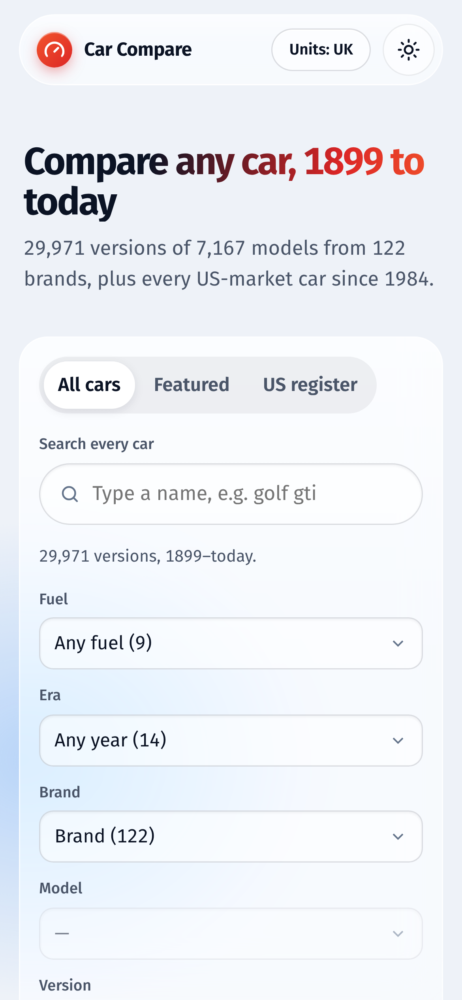<br><sub><b>Search on the go</b></sub></td>
<td align="center">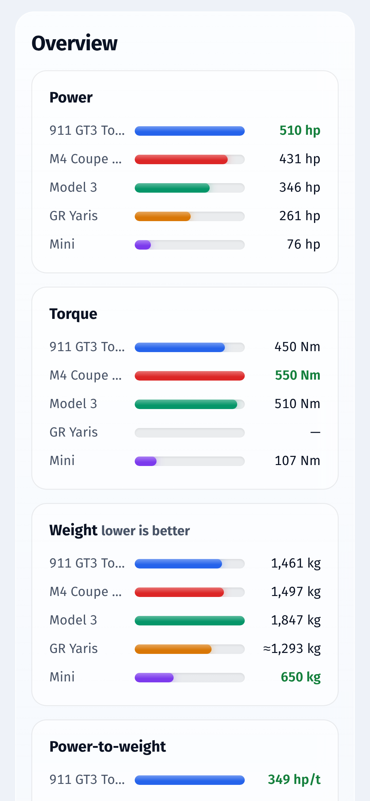<br><sub><b>Charts at a glance</b></sub></td>
<td align="center">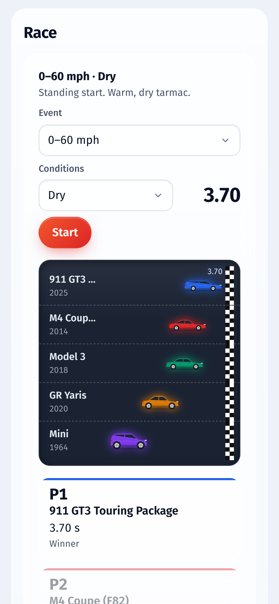<br><sub><b>Race in your pocket</b></sub></td>
<td align="center">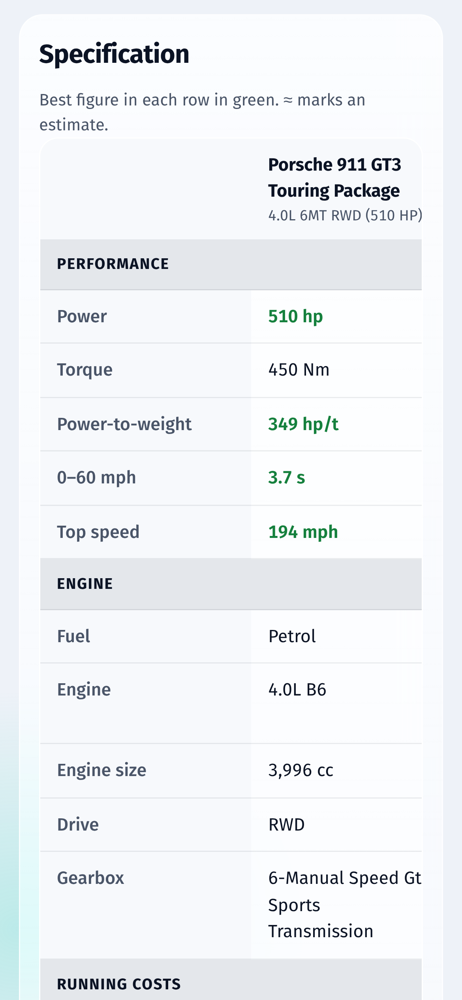<br><sub><b>Every spec, side by side</b></sub></td>
</tr>
</table>
</div>

<div align="center">
<table>
<tr>
<td align="center" valign="top" width="50%">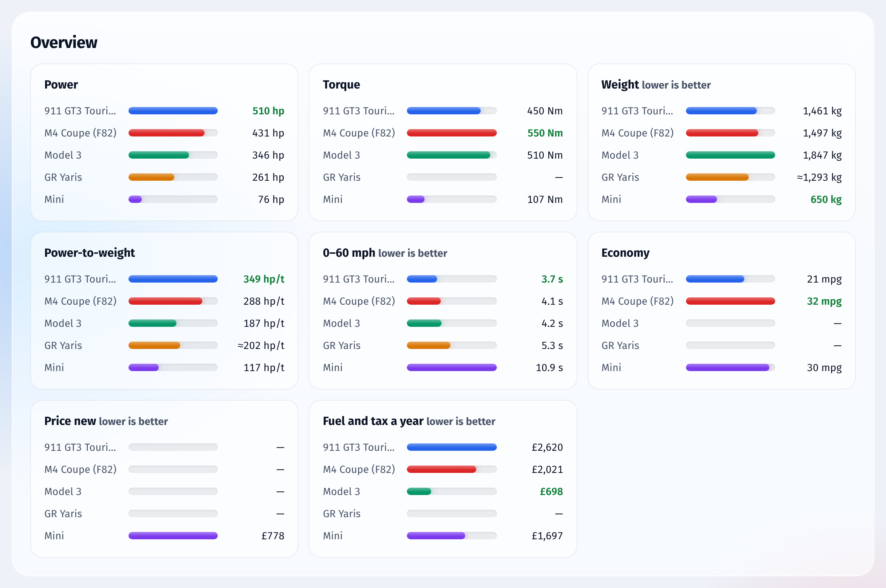<br><sub>Power, torque, weight and more, best in green</sub></td>
<td align="center" valign="top" width="50%">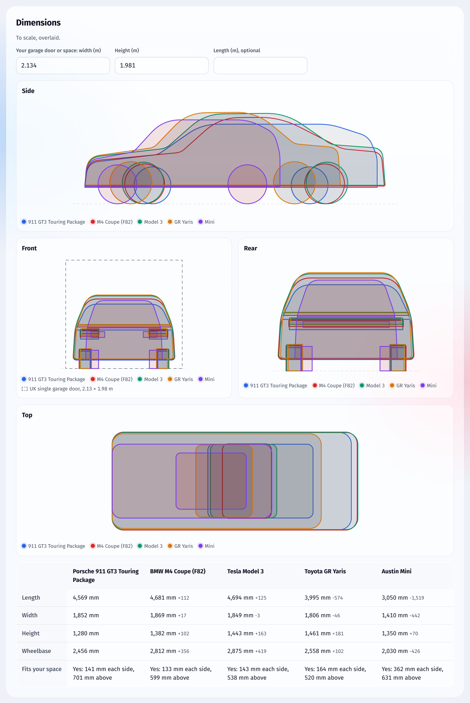<br><sub>Outlines to scale, with a garage door</sub></td>
</tr>
<tr>
<td align="center" valign="top">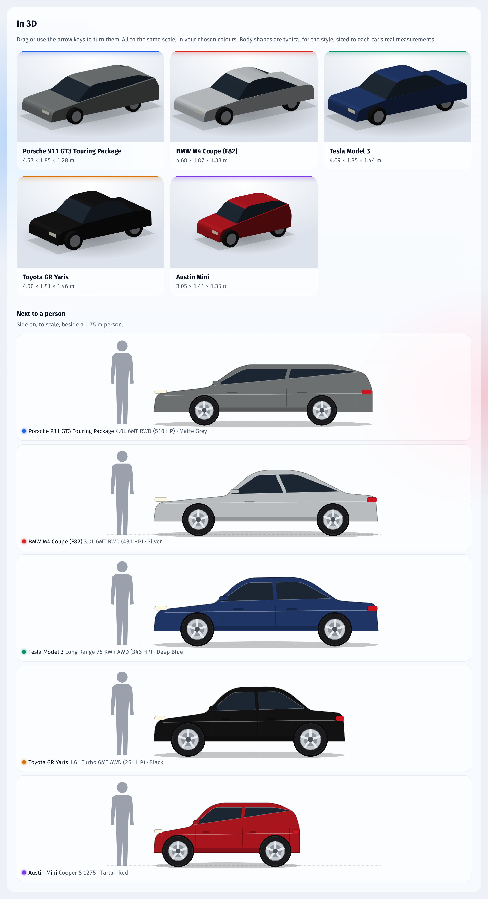<br><sub>3D models, and side drawings next to a 1.75 m person</sub></td>
<td align="center" valign="top">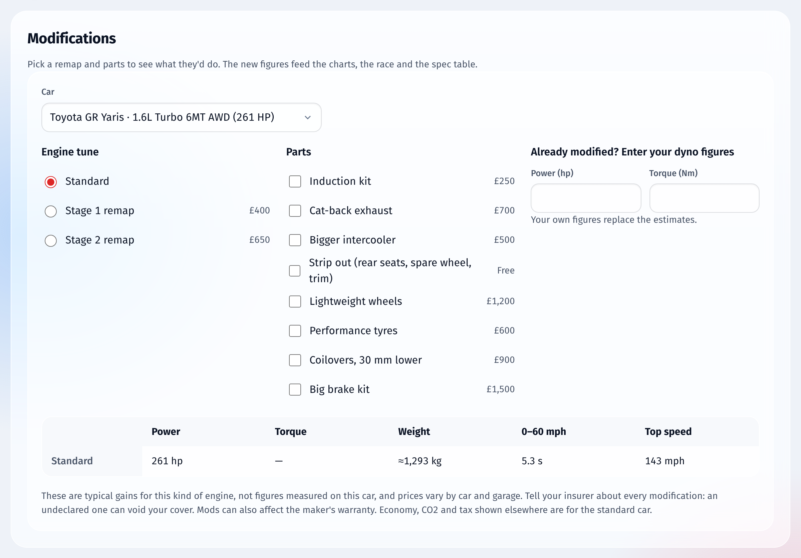<br><sub>Remaps, parts and your own dyno figures</sub></td>
</tr>
<tr>
<td align="center" valign="top">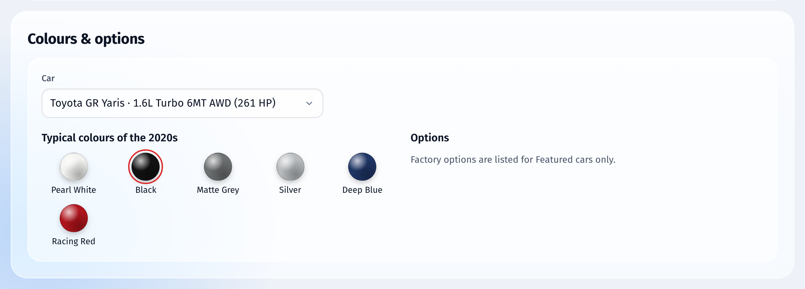<br><sub>Paint and options, priced</sub></td>
<td align="center" valign="top">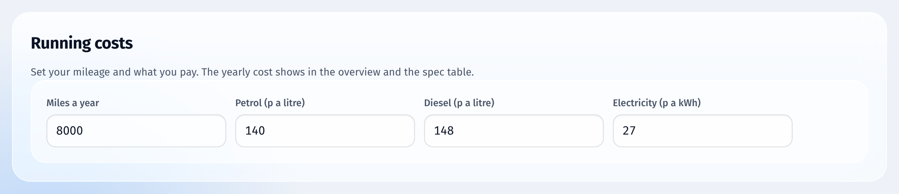<br><sub>Your mileage, your fuel prices</sub></td>
</tr>
</table>
</div>

<details>
<summary><b>Dark theme</b></summary>

<br>

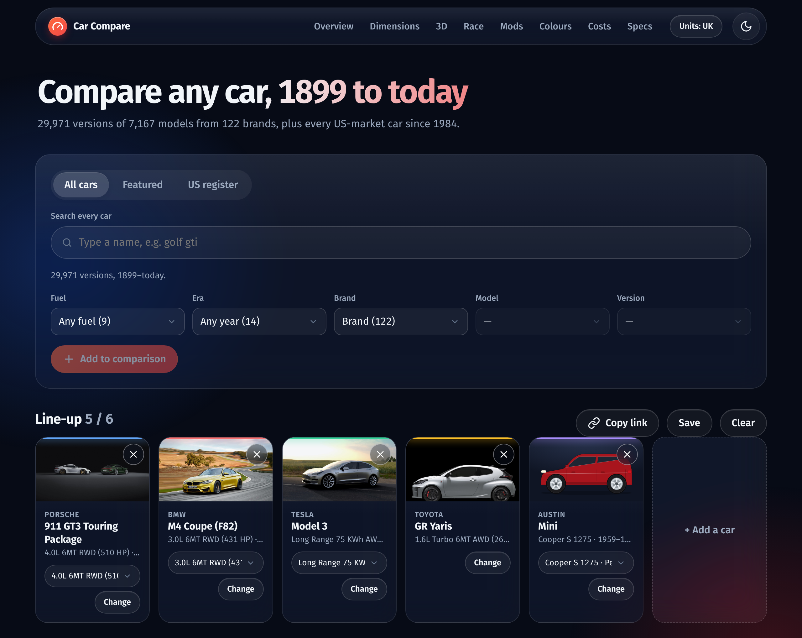

<table>
<tr>
<td width="50%">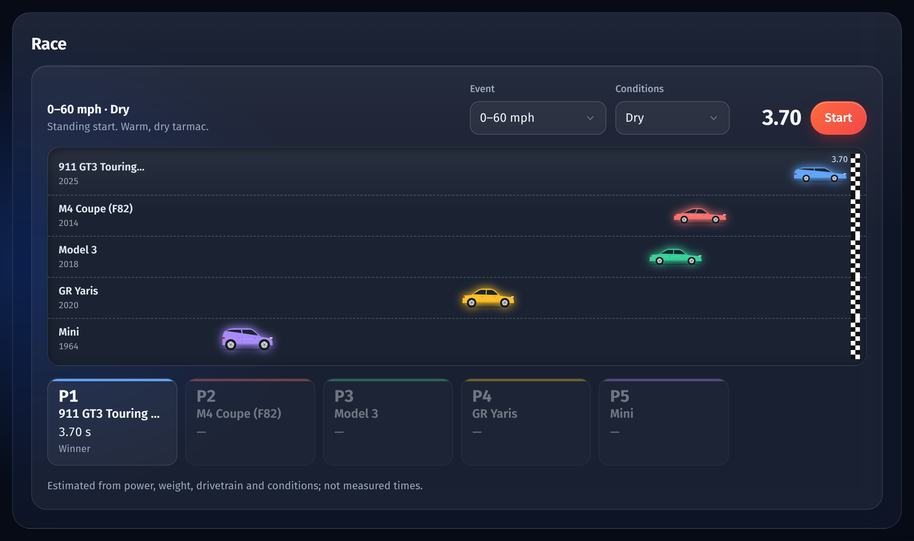</td>
<td width="50%">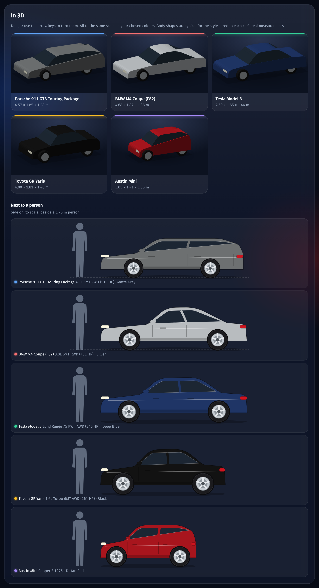</td>
</tr>
</table>

</details>

<br>

## ✦ Where the data comes from

The finder has three tabs, one per source. They can all be mixed in the same line-up.

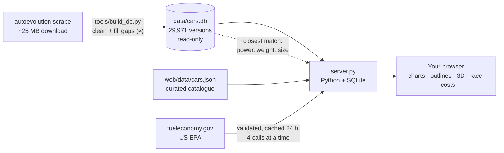

| Tab | What's in it |
|---|---|
| **All cars** (1899–2026) | 29,971 versions with power, torque, weight, 0–60, top speed, economy, CO2, tank, dimensions, boot space and a photo. Built into `data/cars.db` from the open autoevolution dataset. Where the source is missing power, weight or size, the importer estimates them from the version name, sister versions, the car's size or the previous generation, and the app marks those values with **≈**. |
| **Featured** | A small curated catalogue (`web/data/cars.json`) that adds paint colours, options and launch prices, and covers classic British makes the database lacks. |
| **US register** (1984–today) | A live lookup from the US EPA, including the newest US models. The EPA has no power, weight or size figures, so the server borrows them from the closest Full-database match (same make, model, years, fuel and engine size) and labels them "Closest match". No confident match means no borrowed numbers. |

<br>

## ✦ Getting started

Needs **Python 3.10+** only. There are no packages to install.

```bash
git clone https://github.com/landsley-tech/car-compare.git   # or unzip the download
cd car-compare
python3 tools/build_db.py     # first time only: downloads the dataset (~25 MB) and builds data/cars.db (~6 MB)
python3 server.py             # then open http://127.0.0.1:8000
```

**Windows (PowerShell):** the same steps with `py` instead of `python3`, e.g. `py tools\build_db.py` then `py server.py`. If Python isn't installed, get 3.10+ from python.org and tick "Add Python to PATH".

Press Ctrl+C to stop the server. Without the database the app still runs, with the Featured and US register tabs.

<details>
<summary><b>⚙️ Settings (environment variables)</b></summary>

<br>

| Variable | Default | Meaning |
|---|---|---|
| `HOST` | `127.0.0.1` | Address to listen on. Use `0.0.0.0` to reach it from other devices on your home network |
| `PORT` | `8000` | Port |
| `RATE_PER_MIN` | `120` | Requests per minute per visitor before they get "429 Too many requests" |
| `MAX_CONN` | `64` | Total simultaneous connections |
| `MAX_CONN_PER_IP` | `16` | Simultaneous connections per visitor |
| `TRUST_PROXY` | off | `cloudflare` or `caddy` when running behind that proxy on the same machine. Forwarded-IP headers are only trusted from 127.0.0.1 |

</details>

<details>
<summary><b>🏠 Run it on a home server</b></summary>

<br>

On an always-on Linux machine, run this from a clone:

```bash
sudo bash deploy/install.sh
```

It installs the app as a sandboxed systemd service that starts on boot and restarts if it crashes, reachable on your home network and Tailscale at port 8000. Run it again to update.

</details>

<details>
<summary><b>⬆️ Update to the latest version</b></summary>

<br>

Stop the server (Ctrl+C), then from the `car-compare` folder:

```bash
git pull                      # gets the latest code; your data/cars.db is kept (it isn't in git)
python3 tools/build_db.py     # optional: only needed if the release notes say the database changed
python3 server.py             # start it again
```

On Windows use `py` instead of `python3`. If you downloaded a zip instead of cloning, download the new zip, unzip it, and copy `data/cars.db` across from your old folder (or run `build_db.py` again). If you installed it as a home-server service, run `git pull` in your clone and then `sudo bash deploy/install.sh` again.

Your saved line-ups, theme and units are stored in your browser, so updating doesn't touch them. If the page still looks old after updating, hard-refresh it (Ctrl+Shift+R, or Cmd+Shift+R on a Mac). The installed app picks up the new version the next time it's opened online.

</details>

<br>

## ✦ Security

The server is built so that one person can't easily take it down or use it to attack anything else.

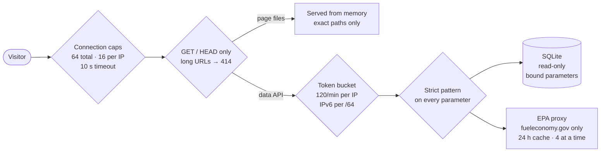

| Threat | Defence |
|---|---|
| **Path traversal** | Static files are loaded into memory at startup and served by exact path, so `/../server.py` is impossible. |
| **Flooding** | Each visitor gets a token bucket for the data API. Page files aren't limited (they come from memory), so people sharing one IP can still load the site. IPv6 visitors are limited per /64 network, so rotating addresses doesn't help. |
| **Spoofed IPs** | Forwarded-IP headers are only believed from the local proxy named in `TRUST_PROXY`, and Caddy's are read from the end the visitor can't fake. |
| **Slowloris** | Total and per-IP connection caps plus a 10-second socket timeout. |
| **Abusing the EPA** | The proxy only talks to fueleconomy.gov, validates every parameter, caches for 24 h and makes at most 4 upstream calls at a time. |
| **SQL injection** | The database is opened **read-only** and every query uses bound parameters with validated input. Search words are bound one by one, `_` is escaped and results are capped at 20, so a search can't dump the database. The tests throw SQL injection at it. |
| **XSS and clickjacking** | Every piece of data is HTML-escaped. A strict Content-Security-Policy (scripts from this site only), `nosniff`, no framing and no referrer. |
| **Tampered links and storage** | Mod names in a share link are checked against the built-in list. Saved line-ups, fuel prices and space sizes from browser storage are validated, and anything tampered with falls back to the defaults. |
| **A hostile dataset** | The download is treated as untrusted: HTML stripped, impossible numbers dropped, only autoevolution CDN photo URLs kept (no `javascript:`), and the zip read by fixed names (no zip-slip). |
| **Styles and motion** | The stylesheet loads nothing from outside (fonts aside): no `@import`, and its only `url()`s are inline SVG icons. Animations are plain CSS plus a few classes the app's own script toggles, so the CSP stays as strict as before. A test fails the build if that changes. |
| **Leaky errors** | Only GET and HEAD are accepted, and upstream error details are never sent to the browser. |

<br>

## ✦ Tests

**112 tests**, plus a checker for a live site.

```bash
python3 -m unittest discover tests     # server, database importer + security/attack tests (54)
node --test                            # tax, race model, mods, costs, outlines, 3D model, escaping, catalogue, whole-fleet checks, stylesheet security (32)
node tests/e2e.mjs                     # 26 steps driving the real page in headless Chrome (add EPA=1 for the live EPA test)
```

| Suite | Count | What it proves |
|---|:---:|---|
| `tests/test_*.py` | 54 | The server, security headers, rate limits, connection caps, the EPA proxy and the importer. **Attacks:** path traversal, SQL injection, floods, slowloris, oversized and malformed requests, spoofed forwarding headers behind Cloudflare and Caddy, hostile dataset rows and zip-slip. |
| `tests/*.test.mjs` | 32 | UK tax, the race model, mods, running costs, outlines, the 3D model, escaping and catalogue data. Every car in the database and catalogue goes through the app's maths, and the race model is checked against tested 0–60 times and top speeds. The stylesheet is checked for outside resources, script tricks and motion outside the reduced-motion guard. |
| `tests/e2e.mjs` | 26 | Drives the real page in headless Chrome: search, filters, all three sources, race, configurator, mods, share links, saved line-ups, tampered storage, units, themes, phone layout, transitions and reduced motion, no console or CSP errors, and offline mode. |

To check a running site the way the public reaches it (security headers, HTTPS, blocked attacks, speed, rate limiting):

```bash
python3 tools/check_public.py https://cars.example.com       # your public address
python3 tools/check_public.py http://127.0.0.1:8000           # local
```

Tested on Python 3.10, 3.12 and 3.14 (Linux). The e2e test looks for Playwright's headless Chrome in `~/.cache/ms-playwright`. To use a different browser, set `CHROME=/path/to/chrome`.

<br>

## ✦ Customising

<details>
<summary><b>Adding cars to the catalogue</b></summary>

<br>

Edit `web/data/cars.json`. Each model has dimensions, colours and add-ons, plus one entry per trim. Copy an existing entry as a template, then run `node --test`. The data checks will catch missing fields, bad colour codes and impossible numbers. Restart the server afterwards, because files are loaded at startup.

</details>

<details>
<summary><b>Changing the modification figures</b></summary>

<br>

The remap and parts list is the `MODS` table near the top of the modifications section in `web/logic.js`. Each entry has a label, a rough fitted cost in pounds, and what it changes: `gain` is `[power ×, torque ×]` for turbo petrol (`tp`), turbo diesel (`td`) and non-turbo (`na`) engines, `kg` is a weight change, `launch` and `corner` scale the race times, and `drop` lowers the car in millimetres. Leave an engine type out of `gain` and the part isn't offered for it. Run `node --test` afterwards and restart the server.

</details>

<details>
<summary><b>Updating the full database</b></summary>

<br>

Run `python3 tools/build_db.py` again, then restart the server. To build from files you've already downloaded, use `--src DIR`.

</details>

<br>

## ✦ Project structure

```
car-compare/
├── server.py               the whole server: static files, data API, EPA proxy, rate limits
├── web/
│   ├── index.html          the app
│   ├── style.css           light and dark themes, responsive
│   ├── app.js              screens, line-up, charts, race, 3D and events
│   ├── logic.js            tax, race model, mods, costs, outlines, 3D meshes (no DOM, unit tested)
│   ├── data/cars.json      the Featured catalogue
│   ├── sw.js, manifest.webmanifest   offline, installable app
│   └── icon-*.png, icon.svg
├── data/cars.db            the Full database (built by tools/build_db.py, not in git)
├── tools/
│   ├── build_db.py         downloads and cleans the dataset, fills gaps
│   └── check_public.py     checks a live site's headers, HTTPS and defences
├── deploy/install.sh       sandboxed systemd service for a home server
├── docs/                   screenshots and GIFs for this README
└── tests/                  Python, Node and headless-Chrome tests
```

<br>

## ✦ Accuracy notes

> Car Compare is for comparing and having fun. Treat the numbers as good estimates, not as official figures.

<details>
<summary><b>What's estimated, and how</b></summary>

<br>

- **Full database:** figures come from autoevolution.com, scraped in October 2024. Some versions share identical specs because of errors in that scrape. 0–60 is converted from 0–62 mph. Body style (used for outlines and race icons) is guessed from the model name and height. Coverage is strongest from the 1990s on. Classic British makes it lacks (Austin-Healey, Triumph, Rover, Morris, Jensen, Hillman, Reliant, Sunbeam, Humber, Riley, Wolseley) are covered by Featured entries instead, some with only one model each.
- **Featured catalogue figures** were compiled by Claude from commonly published and magazine-tested numbers. They have not been checked against official sources, so may be off for your market or spec. Prices are approximate list prices at launch in GBP. To correct anything, edit `web/data/cars.json` and run `node --test`.
- **Race times** use tested 0–60 times where known. Everything else is estimated from power-to-weight, drivetrain, engine type and conditions. Use them for the order and the gaps, not as lap records.
- **Modifications** use typical gains for the type of engine (for example about 22% more power from a Stage 1 remap on a turbo petrol, about 7% on a non-turbo), not figures measured on your car. Costs are rough UK prices. Economy, CO2 and tax stay as the standard car's. In the UK you must tell your insurer about modifications.
- **Fuel cost** uses the official mpg, which most cars don't reach in real driving. Plug-in hybrids are left out because their official mpg assumes a full battery. The starting fuel prices are placeholders: type in what you pay.
- **ULEZ check** is a rule of thumb from fuel and year (petrol from 2006, diesel from 2016, electric and 40-year-old cars pass). Check a real car by registration on the TfL or GOV.UK checker.
- **Fits your space** compares body width, which leaves out the mirrors (about 200 mm more).
- **UK tax** uses the model year as the registration date and 2025/26 rates. The rate tables in `web/logic.js` need updating each April.
- **EPA data** is US-market. Economy is converted to UK mpg and CO2 to g/km, but it comes from the US test cycle.
- **3D models and drawings** are typical shapes for the body style (saloon, hatch, SUV…), sized to each car's real length, width, height and wheelbase, so they aren't exact replicas.

</details>

<br>

## ✦ Release notes

<details open>
<summary><b>23 November 2026</b></summary>

<br>

**New**

- **Liquid glass redesign:** frosted glass panels over a soft colour field, a floating app bar, a segmented source switcher, pill buttons, glossy paint swatches and glowing chart bars. It falls back to solid panels where blur isn't supported or *Reduce transparency* is on.
- **Proper car drawings:** cars without a photo, the race lanes and the side-on drawings now use smooth curved bodies with wheel wells, five-spoke wheels, brake discs, door lines, handles and mirrors, instead of flat blocks.
- **Transitions:** the page eases in on load, sections rise into view as you scroll, new cars pop into the line-up, chart bars glide from their old length to the new one, and switching theme cross-fades. All pure CSS plus a few classes, and all of it is off when *Reduce motion* is on.
- **Better 3D models:** curved body lines, a body that rolls in at the shoulder and sill, a glasshouse that narrows towards the roof, glossy highlights and a soft shadow.
- **More race events:** 0–100 mph, 30–70 mph (rolling) and braking from 60 mph, judged in metres.
- **A physics race model:** each run is simulated step by step (grip, power, air and rolling drag, gear changes), fitted to the tested 0–60 times and top speeds in the database, with tyre grip by era.

**Changed**

- **Cleaner database figures:** the importer now cross-checks power, weight, 0–60 and top speed against each other, fixing dropped digits, km/h stored as mph and pounds stored as kg, and dropping figures that can't be true. Run `python3 tools/build_db.py` again to pick this up.
- **Whole-fleet tests:** every car in the database and catalogue goes through the app's maths, and the race model is checked against the published figures.
- Tests grew to 54 Python, 32 Node and 26 browser steps.

**Known issues**

- UK car tax still uses 2025/26 rates.

</details>

<details>
<summary><b>12 November 2026</b></summary>

<br>

**New**

- **Modifications:** choose a Stage 1 or Stage 2 remap and parts (induction kit, exhaust, intercooler, strip-out, lightweight wheels, tyres, coilovers, brakes) for any car. Power, torque, weight, 0–60 and top speed update in the charts, the race and the spec table, with a rough cost. Enter your own dyno figures if the car is already modified. Share links keep the mods.
- **Search:** type a car's name ("golf gti") instead of using the dropdowns.
- **Yearly running cost:** fuel and tax a year from your own mileage and fuel prices.
- **Fits your space:** enter your own garage door or parking space size and see whether each car fits.
- **Saved line-ups:** a Save button keeps line-ups in your browser.
- **ULEZ / clean air zone check** in the spec table.
- **Units switch:** hp, mph and mpg, or kW, km/h and L per 100 km.
- **3D models** of each car that you can turn, to scale and in your chosen colour.
- **Side drawings** of each car next to a 1.75 m person.
- **Garage door** in the front view of the dimension outlines.
- **Edit the line-up:** a version dropdown on each card, and a Change button to replace a car in place.
- **Four more classic British makes** in Featured: Sunbeam Tiger, Humber Super Snipe, Riley Elf, Wolseley 6/110.

**Changed**

- Acknowledgements and third-party notices expanded; font list corrected.
- Tests grew to 52 Python, 21 Node and 25 browser steps.

**Known issues**

- UK car tax still uses 2025/26 rates.

</details>

<details>
<summary><b>19 October 2026 — first release</b></summary>

<br>

- Compare 1 to 6 cars from three sources: the full database (29,971 versions, 1899–2026), the Featured catalogue and the live US EPA register.
- Overview charts, to-scale dimension outlines, race estimates in five conditions, colours and options, UK car tax and a full spec table.
- Light and dark themes, share links, and an installable app that works offline for Featured cars.
- Gaps in the database filled with estimates, marked with ≈.
- Security hardening: rate limits, connection caps, strict input checks and a read-only database.
- Home server installer (`deploy/install.sh`) and a public site checker (`tools/check_public.py`).
- MIT licence, third-party notices and credits.

</details>

<br>

## ✦ Credits

- **Design and direction: Landsley Bowerman.** Landsley planned the app, chose every feature (the car finder and filters, comparing two or more cars, to-scale outlines, running costs and car tax, colours and options, racing in different conditions, security and self-hosting), set the visual direction, and reviewed and tested the results.
- **Code: Claude** (Anthropic's AI model, Claude Opus 5.5, working in Claude Code). Claude wrote the code, tests and documentation from Landsley's prompts.

<details>
<summary><b>Acknowledgements</b></summary>

<br>

Car Compare is built on information and tools other people made. Thank you to everyone below.

**Data**

- **[autoevolution.com](https://www.autoevolution.com)** for the specifications and photos in the Full database. They researched and published them, and they still own the data and photos.
- **[İlyas Özkurt](https://github.com/ilyasozkurt)** for [automobile-models-and-specs](https://github.com/ilyasozkurt/automobile-models-and-specs), the scrape of autoevolution that `tools/build_db.py` imports (data last updated 23 October 2024).
- **The US Environmental Protection Agency and Department of Energy** for [fueleconomy.gov](https://www.fueleconomy.gov), the live source of the US register (public domain).
- **GOV.UK** for the [vehicle tax rate tables](https://www.gov.uk/vehicle-tax-rate-tables) behind the UK car tax figures. Contains public sector information licensed under the [Open Government Licence v3.0](https://www.nationalarchives.gov.uk/doc/open-government-licence/version/3/).
- **The car makers and the motoring press** whose published specifications, road-test figures, paint and option lists and launch prices the Featured catalogue is compiled from. Car names and badges are trademarks of their owners.

**Design**

- **[Lucide](https://lucide.dev)** and **[Feather](https://feathericons.com)** (Cole Bemis) for the icons.
- **Fira Sans** by Erik Spiekermann, Ralph du Carrois and the Carrois Apostrophe team for Mozilla, served by [Google Fonts](https://fonts.google.com).
- **ui-ux-pro-max**, the Claude Code design plugin used to shape the visual style.

**Tools**

- **[Python](https://www.python.org)** and **[SQLite](https://sqlite.org)**, which run the server and the car database with nothing else to install.
- **[Node.js](https://nodejs.org)** for the unit tests, and **[Chromium](https://www.chromium.org)** from **[Playwright](https://playwright.dev)** for the end-to-end browser tests.
- **[Anthropic](https://www.anthropic.com)**, for Claude and Claude Code.

The 3D models, side drawings, outlines, person figure and race graphics are drawn by the app's own code; no 3D library or third-party artwork is used. The garage door uses the common UK size for a single up-and-over door (7 ft × 6 ft 6 in), and the person is 1.75 m, about the UK adult average.

Full terms for each are in [THIRD-PARTY-NOTICES.md](THIRD-PARTY-NOTICES.md).

</details>

<br>

## ✦ Data and licence

© 2026 Landsley Bowerman. The code is released under the [MIT licence](LICENSE): anyone may use, change and share it, as long as they keep the copyright notice.

The **Full database is not included**. `tools/build_db.py` downloads a community scrape of autoevolution.com, and the photos load from autoevolution's servers. That data and those photos belong to autoevolution, so check their terms before using them on a public site, and they are **not** covered by this licence. US EPA data is US government work (public domain). Third-party icons, fonts and data keep their own terms; see [THIRD-PARTY-NOTICES.md](THIRD-PARTY-NOTICES.md).

> **About the screenshots.** The car photos in `docs/` come from autoevolution, through the app. If you make this repo public, check their terms first, or retake the screenshots with Featured cars only.

<br>

<div align="center">
<sub>Car Compare · Designed by Landsley Bowerman · For anyone who's ever wondered whether a Mini would beat a 911 in the snow.</sub>
</div>
